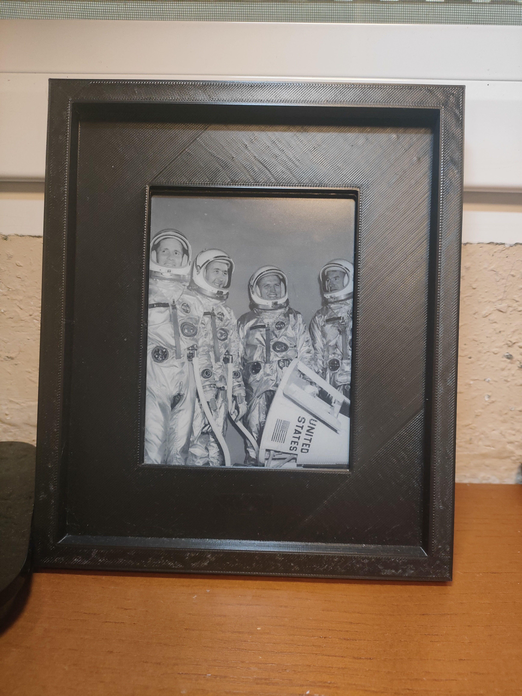
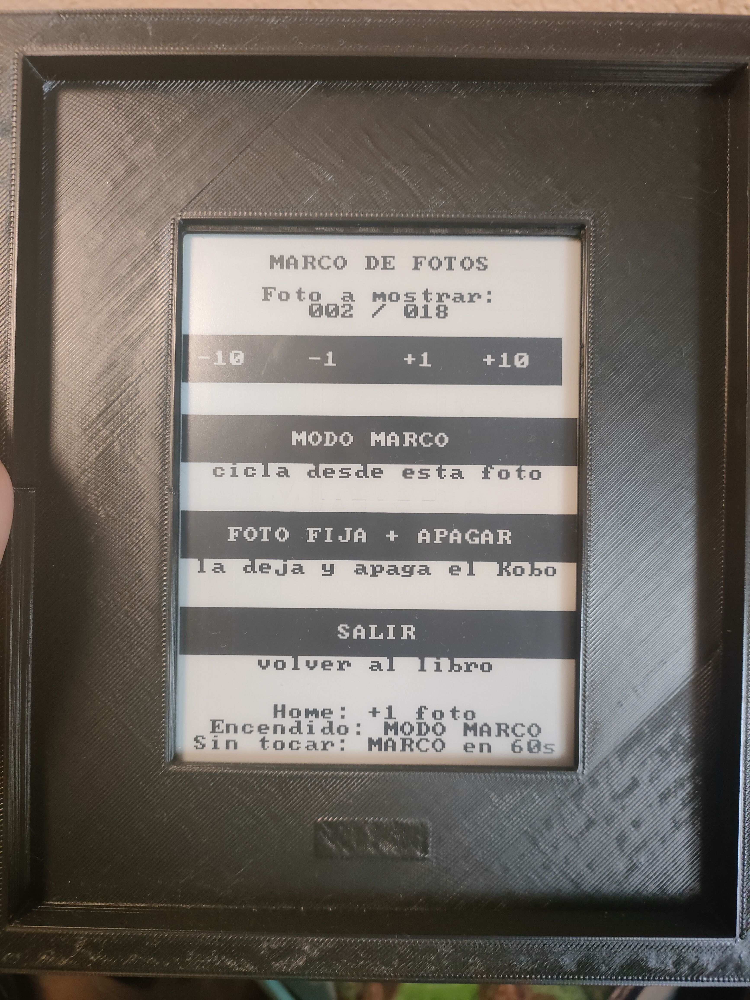

# E-ink photo frame with a Kobo Touch

Turns a **Kobo Touch (N905C)** into an **e-ink photo frame without removing the original system**: the device keeps working as an e-reader and the frame is launched from an icon, as if it were just another book.

An e-ink screen only uses power when the image changes, so between photos the Kobo goes into **deep sleep** and wakes itself up with its internal clock (RTC). With one photo per hour the battery can last a very long time between charges.

<!-- ============================================================
     SPACE FOR PHOTOS OF THE RESULT
     Save the images in docs/photos/ and uncomment/adjust the lines.
     ============================================================ -->

## Result

| Photo on screen | Menu |
|:--:|:--:|
|  |  |

### FreeCAD assembly


---

## Contents

- [What it does](#what-it-does)
- [How it works](#how-it-works)
- [3D model (FreeCAD)](#3d-model-freecad)
- [Requirements](#requirements)
- [Installation](#installation)
- [Usage](#usage)
- [Configuration](#configuration)
- [Preparing the photos](#preparing-the-photos)
- [Repository layout](#repository-layout)
- [Rebuilding](#rebuilding)
- [Troubleshooting](#troubleshooting)
- [Notices](#notices)
- [AI assistance disclosure](#ai-assistance-disclosure)
- [Licenses](#licenses)

---

## What it does

- Shows your photos **full screen** (600×800 pixels, 16 gray levels).
- Changes them every so often (1 hour by default) and **suspends the device between photos**.
- Opening the icon shows a **menu on the Kobo's own screen**:
  - **Pick the photo number** with the −10, −1, +1, +10 buttons (or with the physical Home button).
  - **FRAME MODE**: cycles through the photos starting from the chosen one.
  - **FIXED PHOTO + OFF**: draws the chosen photo and **powers the Kobo off without refreshing the screen again**. The image stays there using no power.
  - **EXIT**: back to the reader.
- You can leave the frame at any time by pressing the power button or plugging in USB.
- It protects itself: if the battery drops below 10 % (configurable) it returns to the reader.
- Everything is written to a text file (`frame.log`) so you can see what happened.

## How it works

```
Nickel (the Kobo's own system)
   │  you open the "Photo frame" icon
   ▼
KFMon ──────────────► .frame/frame.sh
                          │
                          ├─ checks FBInk, photos and battery
                          ├─ stops Nickel (killall)
                          ├─ MENU  ◄── kbinput (buttons and touchscreen)
                          │
                          └─ frame loop:
                                FBInk draws the photo
                                rtcalarm sets the wake-up alarm
                                echo mem > /sys/power/state   (suspend to RAM)
                                … the RTC wakes the Kobo …
                                next photo
```

The pieces:

| Piece | What it is |
|---|---|
| **KFMon** | Third-party program that watches Nickel and runs an action when you open a specific "book". The frame icon is a PNG (`frame.png`) that Nickel shows as a book; opening it makes KFMon launch `frame.sh`. |
| **`frame.sh`** | The main script (shell/BusyBox): menu, photo loop, suspend and safe exit. |
| **FBInk** | Tool that draws text and images straight onto the e-ink screen. A custom build with image support is used. |
| **`rtcalarm`** | Tiny C program that sets the RTC clock alarm (`/dev/rtc0`, via `ioctl`). This Kobo's kernel has no sysfs `wakealarm` interface, hence the need for it. |
| **`kbinput`** | Tiny C program that waits for a button press or a screen touch and prints it. The menu uses it. |
| **Touch calibration** | The first time the menu opens it asks for 3 taps on the corners. That way the script learns which panel axis is X and which is Y, without depending on the model. It is saved in `touch.cal`. |

**Leaving = rebooting.** When the frame ends (or you stop it), the script runs `reboot` and the Kobo boots Nickel as usual. Nothing in the original system is modified except what KFMon installs.

On-screen menu labels and log messages are in English.

## 3D model (FreeCAD)

The physical frame (the enclosure that holds the Kobo) is modeled as a **FreeCAD assembly**.

The files go in [`hardware/freecad/`](hardware/freecad/):

```
hardware/freecad/
├── frame.FCStd          ← complete assembly (to be added)
├── parts/               ← individual parts, if any (to be added)
└── stl/                 ← files for 3D printing (to be added)
```

> **To be filled in:** FreeCAD version used, material, tolerances, hardware (screws) and how the Kobo is held.

## Requirements

- **Kobo Touch N905C** (Kobo Touch "C", Mark 4, i.MX50, 600×800 screen). Tested on this model only. Other Kobo models would need changes.
- **Firmware 3.19.5761** (the latest for this model). KFMon 1.4.6 requires firmware ≥ 2.9.0 and the Touch ships with 2.8.1.
- **KFMon v1.4.6** (separate download, see below).
- A PC (Windows, Linux or macOS) to copy files over USB.
- Python 3 with Pillow (`pip install pillow`) if you want to prepare photos with the script; or just a browser to use the HTML page.

## Installation

> **Before starting:** copy the Kobo's `.kobo` folder to your PC. It holds the library and settings. It is not a way to go back to an older firmware (that is not guaranteed).

1. **Update the firmware to 3.19.5761.** Download the official Kobo `.zip`, extract it into the device's `.kobo` folder, eject USB and wait for it to finish (it takes a while).
2. **Install KFMon.** Download the KFMon v1.4.6 install package (link in its [repository](https://github.com/NiLuJe/kfmon)), copy its contents to the root of the Kobo (it brings `.kobo/KoboRoot.tgz` and `.adds/kfmon/`), eject USB and wait for the reboot.
3. **Copy this project.** Copy the **contents** of the [`kobo/`](kobo/) folder to the Kobo's root (`E:\` on Windows). You should end up with:
   ```
   E:\frame.png
   E:\.frame\frame.sh        (plus fbink, kbinput, rtcalarm-static, config, photos\…)
   E:\.adds\kfmon\config\frame.ini
   ```
4. **Keep scripts with LF line endings.** `frame.sh` already is; if you edit it on Windows, use an editor that saves LF (VS Code, Notepad++…).
5. **Eject USB and reboot the Kobo** (hold the power button and restart). KFMon only reads `frame.ini` at startup, so without a reboot the icon will not work.
6. **Find the icon.** In Nickel a book called *Photo frame* appears (the `frame.png` icon). If your library is filtered by a shelf, look in the general library.
7. **Test** with the test configuration (3 photos at 60 s): edit `E:\.frame\config` with `INTERVAL=60` and `MAX_CYCLES=3`, open the icon with USB **unplugged** and check `E:\.frame\frame.log`. If all goes well, go back to `INTERVAL=3600` and `MAX_CYCLES=0`.

## Usage

1. With USB unplugged, open the **Photo frame** book.
2. **First time:** the device asks for 3 taps (top-left, top-right and bottom-right corners). With the physical **Home** button you can skip calibration and use buttons only.
3. In the menu:

   | Action | How |
   |---|---|
   | Pick a photo | On-screen **−10 / −1 / +1 / +10** buttons, or the **Home** button (+1) |
   | **FRAME MODE** | Tap the button, or press the **power** button |
   | **FIXED PHOTO + OFF** | Tap the button: draws the photo, waits for the refresh to finish and powers off |
   | **EXIT** | Tap the button: back to Nickel |
   | Touch nothing | After `MENU_TIMEOUT` seconds it starts FRAME MODE |

4. **To stop the frame:** press the power button (it wakes early and exits by itself), plug in USB, or create an empty file `E:\.frame\STOP`.
5. **If it hangs:** hold the power button for about 10 seconds.

If the Kobo was powered off by **FIXED PHOTO**, turning it back on boots Nickel normally.

## Configuration

File `E:\.frame\config` (`KEY=value` lines; `#` for comments):

| Key | Default | Meaning |
|---|---|---|
| `INTERVAL` | `3600` | Seconds between photos (max 82800 = 23 h) |
| `MAX_CYCLES` | `0` | Photos shown before returning to the reader (`0` = unlimited) |
| `FLASH_EVERY` | `6` | Full flashing refresh every N photos (clears ghosting) |
| `MIN_BATT` | `10` | Battery % below which it stops |
| `MENU` | `1` | `0` = skip the menu and start directly |
| `MENU_TIMEOUT` | `60` | Seconds of inactivity until it starts by itself (`0` = wait forever) |
| `FIXED_OFF` | `poweroff` | `poweroff` = power off completely; `suspend` = suspend to RAM (Power button returns to the reader) |
| `MENU_DEBUG` | `0` | `1` = saves raw button/touch events to `kbevents.log` |

If anything goes wrong, check **`E:\.frame\frame.log`**: every step is logged.

## Preparing the photos

Photos must be **600×800** PNGs, grayscale, dithered. Two tools are in [`tools/`](tools/):

- **`convert_photos.html`** — open it with a double click in your browser. Drag the photos in, adjust fit, rotation, gray levels, brightness, contrast and gamma, preview the result and download a ZIP with `001.png`, `002.png`… It works offline; the photos never leave your PC.
- **`prepare_photos.py`** — the same conversion from the command line:
  ```
  pip install pillow
  python tools/prepare_photos.py SOURCE_DIR DEST_DIR
  python tools/prepare_photos.py SOURCE DEST --fit                  # no cropping, white borders
  python tools/prepare_photos.py SOURCE DEST --landscape --rotate 90
  ```

Copy the result to `E:\.frame\photos\` (delete the three sample photos first). Photos are shown in filename order.

## Repository layout

```
.
├── kobo/                 ← what gets copied to the Kobo's root
│   ├── frame.png            icon that KFMon watches
│   ├── .adds/kfmon/config/frame.ini
│   └── .frame/              frame.sh, config, fbink, kbinput, rtcalarm-static, photos/
├── src/                  ← source code of kbinput and rtcalarm + build.sh
├── tools/                ← photo preparation (HTML and Python)
├── hardware/freecad/     ← 3D model of the frame (FreeCAD assembly)
├── docs/photos/           ← photos of the result for this README
├── THIRD_PARTY.md        ← third-party software and licenses
└── LICENSE
```

## Rebuilding

`kbinput` and `rtcalarm` are written in C and cross-compiled for ARM with [Zig](https://ziglang.org/):

```
pip install ziglang
./src/build.sh
```

FBInk was built from the official source code; the exact details are in `kobo/.frame/FBInk-README.txt`.

## Troubleshooting

| Symptom | What to check |
|---|---|
| The icon does not appear | Did you reboot the Kobo after copying `frame.ini`? Is `frame.png` in the root? Are you in the general library, not on a shelf? |
| Nothing happens when opening the icon | Check `E:\.frame\frame.log`. Make sure `frame.sh` is saved with LF line endings. |
| "NO RTC alarm" in the log | The wake-up alarm is not working: the frame still runs, but without suspending (more battery use). Check that `rtcalarm-static` is in `.frame`. |
| The menu does not respond to touch | Delete `E:\.frame\touch.cal` and recalibrate, or set `MENU_DEBUG=1` and check `kbevents.log`. The physical buttons work without calibration. |
| The screen changes after **FIXED PHOTO** | Set `FIXED_OFF=suspend`. |
| It hung | Hold the power button for ~10 s. |

## Notices

- Personal project, **no warranty**. You modify your device at your own risk.
- Tested only on a **Kobo Touch N905C** with firmware **3.19.5761**. Other models or versions may need changes.
- A firmware update or a factory reset can remove KFMon; it would have to be reinstalled.
- Independent project, not affiliated with Rakuten Kobo.

## AI assistance disclosure

The idea, the hardware, the physical frame design and all testing on the real device are by Pablo Barranco. The software in this repository (scripts, C programs, photo tools and documentation) was developed **with the assistance of an AI chat assistant**, which wrote and revised code and text during development. The result was run and tested on the actual Kobo Touch; log files from those tests were used to fix problems along the way. As with any code you run on your own device, read it before using it.

## Licenses

The original code in this repository is under the **MIT license** (see [`LICENSE`](LICENSE)). The FBInk binaries are **GPL-3.0**. More details in [`THIRD_PARTY.md`](THIRD_PARTY.md).
